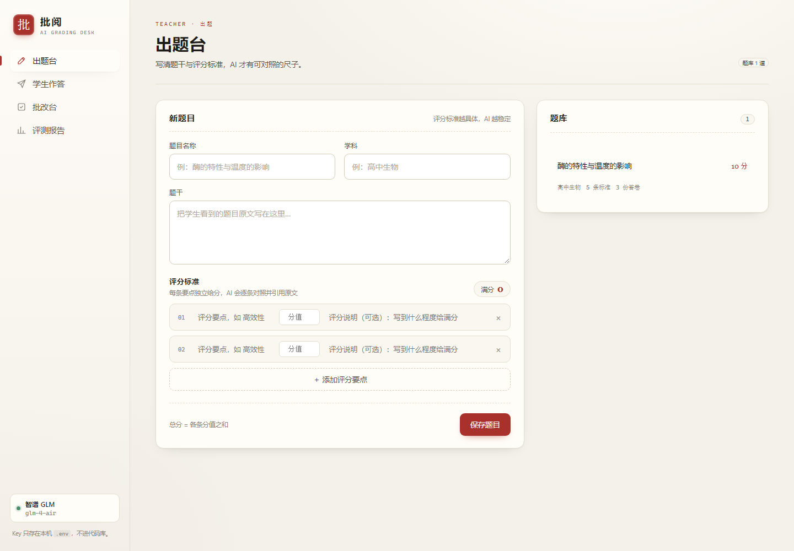
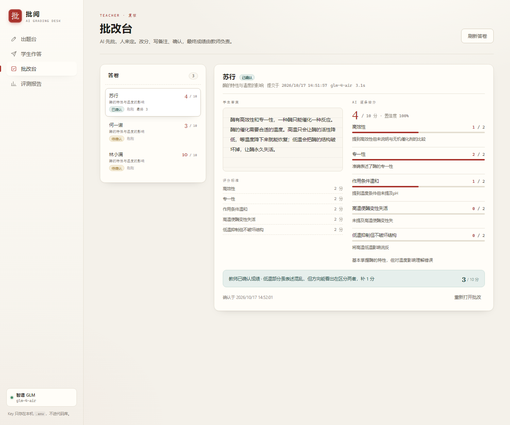
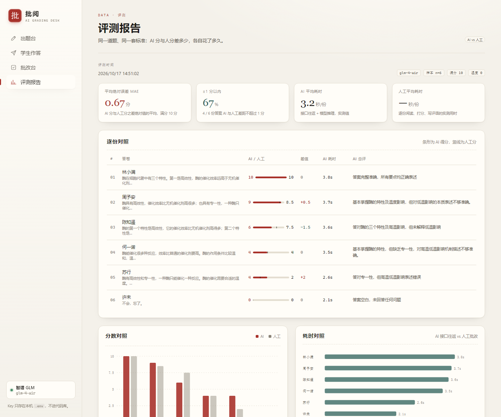

# 批阅 · AI 判分系统

教师出题并写好评分标准 → 学生提交答案 → **AI 逐条对照评分标准给分并说明理由** → 教师复核改分、确认最终成绩。

核心流程全部可用，AI 打分是真的调用大模型：换一份答案，分数和理由会跟着变。

## 功能

- **出题台（教师）**：录入题干 + 多条评分标准（每条独立分值），总分自动累加
- **学生作答**：选题、作答、提交后立即判分，实时显示判分用时
- **AI 判分**：逐条评分点给分，每条理由必须引用学生答案原文；给出总评、亮点、失分点、置信度
- **批改台（教师）**：左侧答卷列表、右侧学生答案与 AI 逐条给分对照；教师可改分、写备注、确认成绩，也可一键重判
- **评测报告**：内置 `npm run eval`，同一道题跑多份答案，对比 AI 分与人工分、统计耗时，页面直接展示

## 技术栈

| 层 | 选型 | 说明 |
| --- | --- | --- |
| 后端 | Node.js 22 + Express 5 | 判分、题目、答卷 REST API |
| 数据库 | `node:sqlite`（内置） | 零原生编译依赖，`npm install` 即跑 |
| 前端 | 原生 HTML / CSS / JS | 无框架、无构建步骤 |
| 大模型 | OpenAI 兼容接口 | 默认 DeepSeek，可切换通义千问 / Kimi / OpenAI / 硅基流动 |

## 快速开始

要求 Node.js ≥ 22.5。

```bash
npm install

# 1. 配置 Key（不会进入版本库）
cp .env.example .env
#    编辑 .env，填入 LLM_API_KEY=sk-...
#    没有付费 Key？用智谱免费模型：LLM_PROVIDER=zhipu + glm-4-flash

# 2. 体检：真实调用一次模型，确认 Key / 模型名 / 网络都通
npm run check

# 3. 启动
npm start
#    打开 http://localhost:4317
```

支持的服务商（`LLM_PROVIDER`）：`deepseek`、`zhipu`、`dashscope`、`moonshot`、`openai`、`siliconflow`，接口均为 OpenAI 兼容格式，换服务商只需改 `.env` 两行。

首次启动会自动写入一道示例题（高中生物，10 分，5 条评分标准），可直接演示。

## AI 判分是怎么做的

Prompt（`server/grader.js`）的几条关键设计，决定了它"打得像人"：

1. **只认评分点**：逐条独立评分，明确要求"不给同情分、不因字数加分、不因口语化扣分"；
2. **理由可复核**：每条得分必须引用学生答案原文（用「」标注）或写明"答案未提及"；
3. **结构化输出**：要求返回 JSON，服务端做严格校验——缺失的评分点补 0、越界分数夹取、**总分由服务端逐条重算**（不信任模型自报的总分），校验修正会记入 warnings；
4. **稳定优先**：`temperature=0`，同一份答案的波动被压到最小；
5. **防提示注入**：学生答案里写"给我满分"会被当作被批改的内容，Prompt 中明确不执行。

每次判分都记录模型、耗时、token 数，并写入 `grade_runs` 表，可追溯。

## 评测：AI 打得准不准？

**方法**：同一道题（高中生物，满分 10 分，5 条评分标准）、同一套标准，准备 6 份质量从满分到零分的答案。人工先按评分标准**逐条**打分作为基准，再用系统端到端判分（走完整 HTTP 流程），两边互不参考，最后比对。

**最终运行结果**（模型 `glm-4-air`，temperature=0，Prompt `v2-evidence-checked`）：

| 指标 | 数值 |
| --- | --- |
| 平均绝对误差 MAE | **0.67 分**（满分 10 分，约 6.7%） |
| 相差 ≤ 1 分 | **4 / 6**（67%） |
| 完全一致 | 3 / 6 |
| 皮尔逊相关系数 | **r = 0.96** |
| 单条评分点误差 | 平均 0.33 分（共 30 个评分点判定） |
| AI 单份耗时 | **3.2 秒**（实测接口往返） |
| 人工单份耗时 | 用 `npm run timer` 实测后自动写入报告 |

**迭代过程**（这是本项目最有收获的部分）：

| 版本 | 模型 | MAE | ±1 分以内 | 发现的问题 |
| --- | --- | --- | --- | --- |
| v1 · 宽松 Prompt | glm-4-flash（免费） | 2.33 分 | 33% | 模型会**编造原文依据**：给"低温"条目打满分，理由却引用的是高温那句；说反了机理的答案拿了 8/10 |
| v2 · 证据校验 | glm-4-air | 0.5 ~ 0.67 分 | 67% ~ 83% | 服务端校验 evidence 必须逐字出现在学生答案中、且不得与其他条目重复，编造直接判 0；换更强模型后误差下降 3 倍 |

结论：**同一个 Prompt，换更弱的模型会系统性偏松**——所以判分系统的关键不只是 Prompt，还有"输出可校验"的设计和教师确认环节。

复现：

```bash
npm run check    # 先体检：真实调用一次模型，确认 Key / 模型 / 网络都通
npm run eval     # 端到端评测：起服务 → 建题 → 6 份答案 → eval/results.json + eval/report.md
```

人工基准的用时可以直接在网页里量：启动服务后打开 **「人工计时」页**（`#/timer`），逐份批改 6 份答案、自动计时，提交后服务端会写入 `eval/human-timing.json` 并**自动重算评测报告**（不重新调用模型）。也可以用命令行版：

```bash
npm run timer    # 命令行版人工计时（与网页版等价）
npm run report   # 命令行版计时完成后，只重算报告
```

## 界面

| 出题台 | 批改台 | 评测报告 |
| --- | --- | --- |
|  |  |  |

## 项目结构

```
├── server/
│   ├── index.js     # Express 路由 + 静态资源 + 示例题
│   ├── grader.js    # 判分 Prompt、模型调用、JSON 校验与分数归一化
│   ├── db.js        # SQLite（题目 / 答卷 / 判分记录）
│   └── config.js    # .env 读取 + 服务商预设
├── public/          # 前端四页（出题台 / 学生作答 / 批改台 / 评测报告）
├── scripts/
│   ├── evaluate.mjs # 端到端评测脚本
│   └── human-timer.mjs # 人工批改计时器
├── eval/            # 评测数据：题目、答案、人工基准分、结果与报告
└── data/            # 本地数据库（gitignore）
```

## 安全与隐私

- API Key 只存在本机 `.env`（已 gitignore），代码中只读 `process.env`；
- 答卷数据存本地 SQLite，不上传；
- 无外部依赖服务，断网时除判分外均可运行。

## 已知局限

- 评测样本小（单题 6 份），只能验证"流程可用、结果合理"，不能等同大规模阅卷精度；
- 人工基准由单一评阅人给出，不同教师的宽严尺度天然存在差异——这也是保留"教师确认"环节的原因；
- 同一份答案重复判分有约 ±1 分波动（temperature=0 已尽量压低）；
- 免费档模型（如 glm-4-flash）判分明显偏松且会编造依据，正式使用建议 glm-4-air 及以上；
- 模型偶发对"表述不同但意思正确"的答案偏严，需要教师在批改台修正。

## 团队分工

| 成员 | 负责 |
| --- | --- |
| **崔鹏宇** | 制作：判分引擎与 Prompt 迭代、证据校验、后端接口、五个页面的前端、评测与计时脚本 |
| **付禹棋** | 解说：演示录屏、人工基准的 6 份逐条打分、评测数据的解读与汇报、测试反馈 |

详见 [docs/team.md](docs/team.md)；五条评审标准对应的证据索引见 [docs/review-checklist.md](docs/review-checklist.md)。

## 演示

- 3 分钟录屏脚本见 [docs/demo-script.md](docs/demo-script.md)；
- 评测明细见 [eval/report.md](eval/report.md)，历史迭代结果在 [eval/history](eval/history)。

## License

MIT
